<a id="top"></a>

<div align="center">


# Moby

**Early warnings that reach you, even with little or no signal.**

Moby is an open-source disaster early-warning app for locals and travellers in places where official alerts
don't reach. It gathers official hazard warnings from around the world, adds reports from people nearby,
explains them in plain words with NVIDIA Nemotron, and tells you what to do.

[](LICENSE)
[](https://github.com/Xlient/Moby/actions/workflows/ci.yml)


[](https://github.com/sponsors/Xlient)

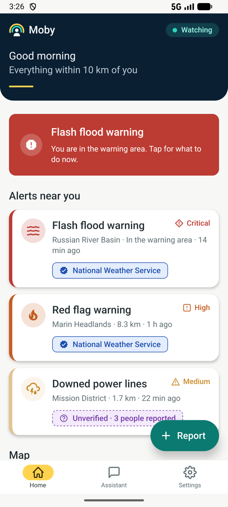&nbsp;
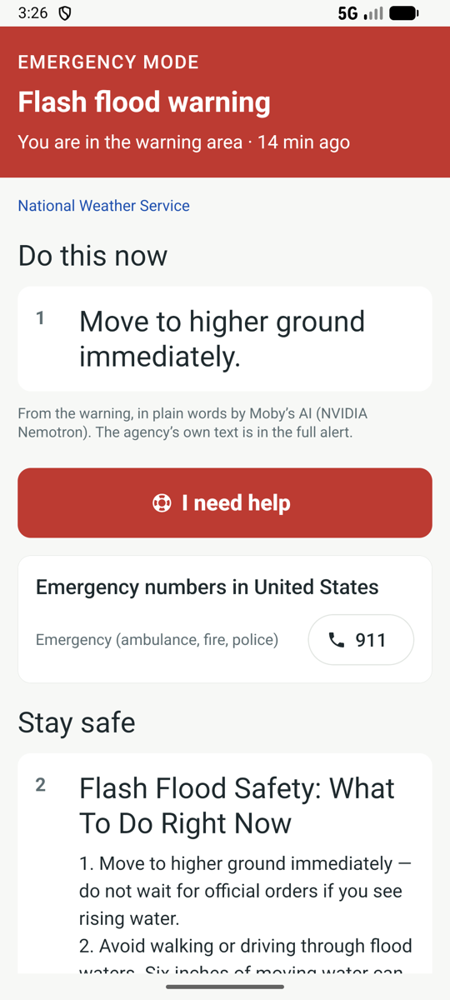&nbsp;
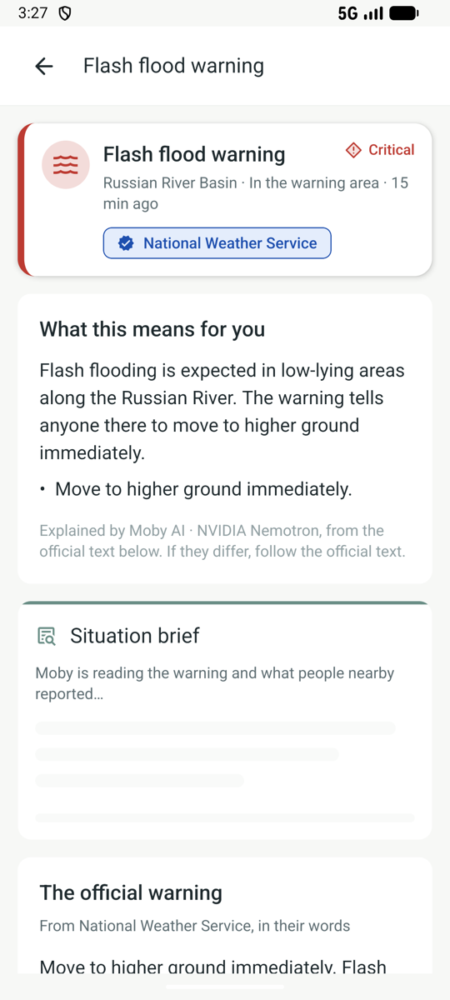&nbsp;
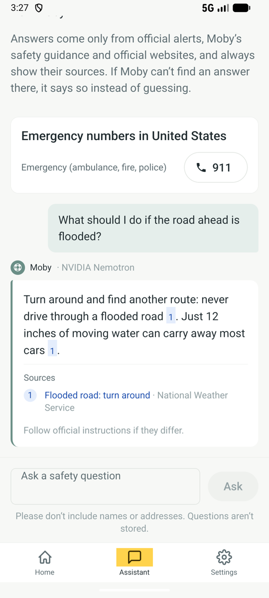

</div>

> [!IMPORTANT]
> Moby adds to official warning systems. It does not replace them. Always follow instructions from local
> authorities and emergency services.

**Contents:** [Install](#install) · [Walkthrough](#walkthrough) · [What Moby does](#what-moby-does) ·
[Models](#models) · [Architecture](#architecture) · [Run from source](#run-from-source) ·
[Contributing](#contributing) · [Sponsoring](#sponsoring) · [License](#license)

---

## Install

| Platform | Get it | Notes |
|---|---|---|
| **Android** (Google Play) | Join the [closed test](#android-join-the-google-play-test), then [install from Google Play](https://play.google.com/store/apps/details?id=com.xlient.moby) | Updates arrive through Play. |
| **Android** (phone or emulator) | `Moby-<version>.apk` from [Releases](https://github.com/Xlient/Moby/releases) | Signed release build. Connects to the live service. |
| **iOS Simulator** (Mac) | `Moby-simulator.zip` from [Releases](https://github.com/Xlient/Moby/releases) | Push notifications are Android-only for now. |
| **iPhone** | Build from source ([iOS](#ios-from-source)) | Not on the App Store or TestFlight yet; the [TestFlight pipeline](#releasing-maintainers) is ready once there is an Apple Developer membership. |
| **Browser** | Run from source with demo data ([2 minutes](#a-the-app-with-demo-data)) | No account or keys needed. |

**Sign in** with any Google account. Judges can use the test account in the Devpost testing instructions.

**Bluetooth mesh and SOS to nearby phones are Android-only.** iOS doesn't let apps put data in Bluetooth
advertisements, so on iPhone and the iOS Simulator those two options are hidden. The iPhone design is tracked
in [#83](https://github.com/Xlient/Moby/issues/83). Everything else works on both.

<a id="android-join-the-google-play-test"></a>
<details>
<summary><b>Android: join the Google Play test</b></summary>

Moby is in a closed test on Google Play. Anyone can join:

1. Join the testers group, [moby-testers@googlegroups.com](https://groups.google.com/g/moby-testers), with the
   Google account you use on your phone (**Join group**).
2. Open the [testing page](https://play.google.com/apps/testing/com.xlient.moby) with the same account and tap
   **Become a tester**.
3. Install Moby from [Google Play](https://play.google.com/store/apps/details?id=com.xlient.moby). It can
   take a few minutes after joining before the Play listing shows up for you.

</details>

<details>
<summary><b>Android: install the APK</b></summary>

1. **Emulator:** install [Android Studio](https://developer.android.com/studio), open **Device Manager**, create
   any Pixel phone with a recent Google APIs image, and start it. **Phone:** skip this step.
2. Download `Moby-<version>.apk` from [Releases](https://github.com/Xlient/Moby/releases). Drag it onto the
   emulator window, or run `adb install Moby-<version>.apk`. On a phone, open the file and allow installs from
   your browser.
3. Open **Moby** and sign in. Allow location, or leave it off to see alerts around San Francisco.

To place an emulator somewhere specific, use the emulator's **⋯ → Location** panel, or
`adb emu geo fix <lon> <lat>`.

</details>

<details>
<summary><b>iOS Simulator: install the app</b></summary>

Needs a Mac with Xcode. No Apple account is required. Open Xcode once and accept the iOS Simulator download
it offers (or run `xcodebuild -downloadPlatform iOS`). Unzip `Moby-simulator.zip` to get `Moby.app`, then:

```bash
open -a Simulator
xcrun simctl install booted Moby.app
xcrun simctl launch booted com.xlient.moby
```

Set a location with the Simulator's **Features → Location** menu.

</details>

<details>
<summary><b>The live service</b></summary>

Release builds talk to Moby's API on a Nebius Serverless Endpoint. It stays up at the same address through
the end of judging (15 December 2026), and a health check runs every 30 minutes
([`uptime.yml`](.github/workflows/uptime.yml)). The address is built into the release builds rather than
published, because every request needs a Firebase App Check token that only the official signed app can get.
Builds from source without an API address run on built-in demo data instead.

</details>

<p align="right"><a href="#top">Back to top ↑</a></p>

---

## Walkthrough

About ten minutes. Real emergencies are rare where most people test, so start with **Demo mode**: it replays
real past warnings around you, marks each one **Demo**, and only your phone sees them. Push notifications,
reports and SOS keep using your real location.

The screenshots are from an Android emulator running the [demo-data build](#a-the-app-with-demo-data). On the
live service, Demo mode replays warnings from your own region, so the alerts you see will differ.

<table>
<tr>
<td width="33%" valign="top">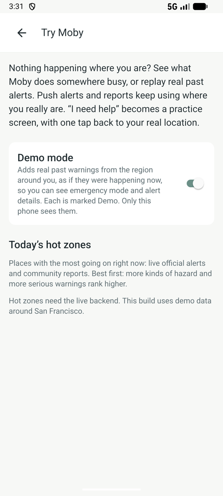</td>
<td valign="top">

### 1. Turn on Demo mode

**Settings → Try Moby → Demo mode.** Home shows a *Trying Moby* banner with a **Stop demo** button.

The same screen lists **today's hot zones**: the places with the most live official alerts right now. Tap one
to look at Moby there instead of where you are. Hot zones need the live service, so builds running on demo
data show a note instead.

</td>
</tr>
<tr>
<td valign="top"></td>
<td valign="top">

### 2. Emergency mode

When a severe warning covers your location, Moby opens **emergency mode** on its own: what to do first, an
**I need help** button, and the local emergency numbers. Everything on this screen works without signal.

The first step is written by Nemotron from the agency's warning. The agency's own words are one tap away in
**Full warning**.

</td>
</tr>
<tr>
<td valign="top">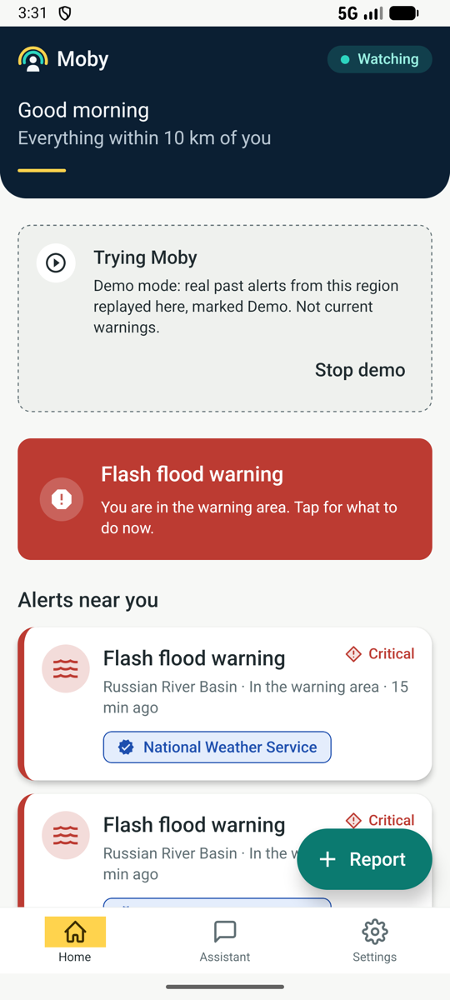</td>
<td valign="top">

### 3. Home

Close emergency mode to see **Home**: every alert within the radius you choose, each labelled with who issued
it. **Official** means an agency issued it. **Unverified** means people nearby reported it, with how many.
Tap the radius on the map to change it.

</td>
</tr>
<tr>
<td valign="top"></td>
<td valign="top">

### 4. An official alert

Open an alert marked with an agency name. **What this means for you** explains it in plain words. Below it are a
situation brief, the agency's original text, **How sure we are**, and safety guidance from official sources.

Warnings issued in another language are translated, with the original one tap away.

</td>
</tr>
<tr>
<td valign="top">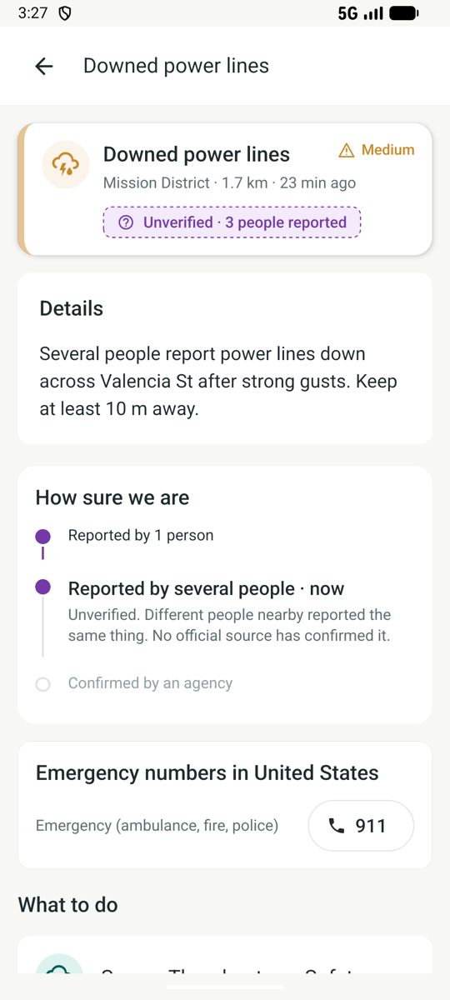</td>
<td valign="top">

### 5. A community report

Go back and open an alert marked **Unverified**. Reports from people nearby are never styled like official warnings
and never wait for a reviewer. Each user chooses whether to be notified about them.

Tap **Report** on Home to send one yourself.

</td>
</tr>
<tr>
<td valign="top"></td>
<td valign="top">

### 6. Ask Moby

Open the **Assistant** tab and ask *"What should I do if the road ahead is flooded?"*. Every answer cites its
sources. If the sources don't cover the question, Moby says so instead of guessing.

**Settings → Offline answers** downloads a small on-device model so Ask Moby works with no signal.

</td>
</tr>
<tr>
<td valign="top">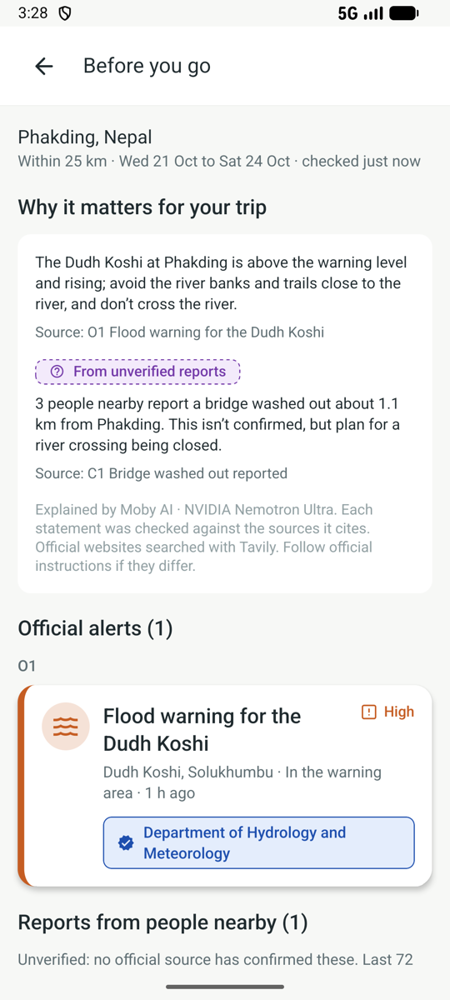</td>
<td valign="top">

### 7. Before you go

From Home, open **Before you go** and search for **Phakding** (Nepal), or switch to **A route** and add
Lukla → Phakding → Namche Bazaar. Moby lists the alerts and reports there, explains why they matter for the
trip, and saves the brief on the phone with the emergency numbers.

</td>
</tr>
<tr>
<td valign="top">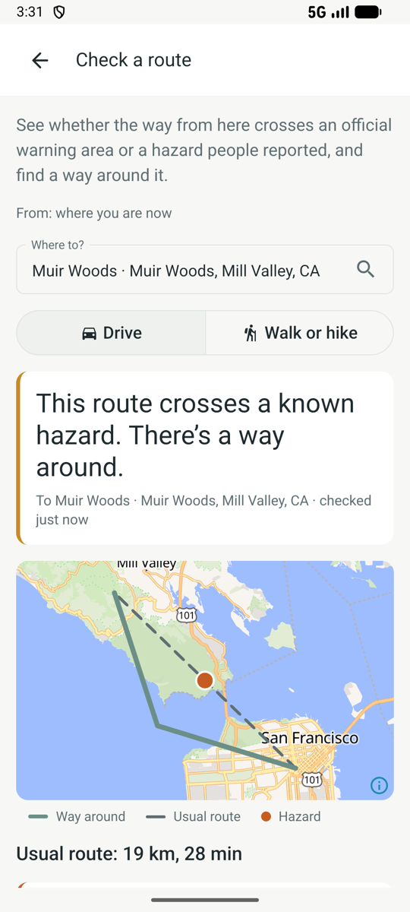</td>
<td valign="top">

### 8. Check a route

From Home, open **Check a route** and pick a destination. Moby shows whether the usual route crosses an
official warning or a reported hazard, and offers a way around it. It never calls a route safe; it only
reports what it knows about.

</td>
</tr>
<tr>
<td valign="top">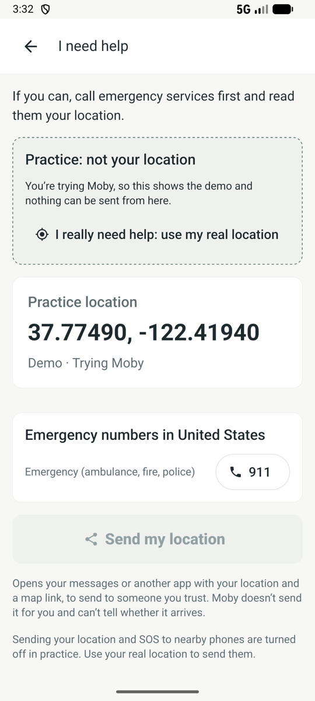</td>
<td valign="top">

### 9. I need help

From Home, tap **I need help**: your exact coordinates to read to a dispatcher, the emergency numbers, and
**Send SOS to nearby phones**, which passes an SOS phone to phone over Bluetooth when there is no signal
(Android, opt-in under **Settings → Share through nearby phones**).

In Demo mode this is a practice screen: nothing can be sent, and **I really need help** switches back to your
real location in one tap.

When you're done, tap **Stop demo** on Home.

</td>
</tr>
</table>

**Settings → About Moby → How Moby uses AI** lists which model does what, and what AI never decides.

<p align="right"><a href="#top">Back to top ↑</a></p>

---

## What Moby does

Floods, typhoons, earthquakes and wildfires are most dangerous where warnings struggle to arrive: trekking
routes, valleys, islands and rural areas where the phone network fails first. Travellers also face warnings
in a language they don't read, from agencies they don't know.

| Problem | What Moby does |
|---|---|
| **Warnings don't reach remote places** | Watches official sources worldwide (NWS, USGS, EMSC, GDACS, NASA EONET, PTWC, NHC, JTWC, JMA, Nepal's BIPAD, MeteoAlarm and national Common Alerting Protocol feeds) and pushes the ones near you and your saved places. Critical alerts near you always get through, whatever your settings. |
| **Rumours can look official** | Every item is labelled **Official** or **Unverified**, with how many people reported it. |
| **Warnings in an unfamiliar language** | Translated and explained in 17 languages. Every number is checked against the original, which stays one tap away. |
| **No signal** | Safety steps and local emergency numbers are stored on the phone, and Ask Moby can answer with an on-device model. |
| **No signal and you need help** | **Bluetooth mesh SOS** (Android only, opt-in; iPhone in [#83](https://github.com/Xlient/Moby/issues/83)). Nearby Moby phones repeat an SOS for up to 6 hours and upload it once one of them reconnects. |
| **Is the road ahead safe?** | **Route hazard check** against active warnings and reports, with a way around them. |
| **Planning a trip** | **Before you go** briefs for a destination or route, saved for offline use. |

Two rules hold everywhere:

1. **Never a false all-clear.** If Moby can't check, it says so. It never shows "all quiet".
2. **Models never decide whether something is confirmed or how urgent it is.** Those are plain rules in
   `moby/escalation/`.

<p align="right"><a href="#top">Back to top ↑</a></p>

---

## Models

<details>
<summary><b>Model tiers, what each one does, and how its output is checked</b></summary>

Server-side models run on [Nebius Token Factory](https://tokenfactory.nebius.com/) through its
OpenAI-compatible API. `moby/llm.py` chooses the tier for each feature (model ids in `moby/config.py`). Every
model output passes a check before anyone sees it, and when a check fails the reader gets the official text.

| Model | Runs on | Used for | Checks |
|---|---|---|---|
| **NVIDIA Nemotron 3.5 Lightning** (`nvidia/Nemotron-3_5-Lightning`) | Token Factory | Translating non-English warnings on ingest (`moby/feeds/translate.py`), rewriting Ask Moby questions into search queries without personal details (`moby/ai/ask.py`), extracting fields from report notes (`moby/graph/structure.py`). | Every number in the original must survive translation, or the original is shown. Extraction may only fill fields the note states. |
| **NVIDIA Nemotron 3.5 Super** (`nvidia/Nemotron-3.5-Super-VL`) | Token Factory | *What this means for you* and push text (`moby/ai/explain.py`), Ask Moby answers with `[n]` citations, translation into the phone's language (`moby/ai/localize.py`), "what changed" since the last brief (`moby/graph/brief_changes.py`). | Grounding checks (`moby/ai/grounding.py`): no number missing from the source, wording traceable to the cited sources. Ask Moby abstains when its sources don't cover the question. |
| **NVIDIA Nemotron 3 Ultra** (`nvidia/Nemotron-3-Ultra-550b-a55b`) | Token Factory | Trip briefs (`moby/ai/trip.py`), situation briefs for people near a hazard (`moby/graph/brief_writer.py`), and the offline safety guidance cards built from official pages, as a Serverless Job (`moby/jobs/guidance.py`). | Every statement cites an alert, report or official page, and its numbers, names and hazards must appear there. Each guidance line cites its source line. |
| **Qwen3-Embedding-8B** (1024-d) | Token Factory | Retrieval over the guidance cards for Ask Moby (pgvector), and event embeddings. | Similarity cut-offs tuned on real questions. |
| **NVIDIA Nemotron 3 Nano 4B** (Q4_K_M GGUF, 2.8 GB) | The phone, via [llama.rn](https://github.com/mybigday/llama.rn) | Offline Ask Moby (`src/ondevice/`), answering from the guidance stored on the phone. Downloaded on request over Wi-Fi from NVIDIA's Hugging Face repo; needs about 8 GB of RAM. | The same grounding rules, on the phone (`src/ondevice/grounding.ts`). `scripts/ondevice-eval.ts` evaluates it with llama.cpp. |

Lightning handles the high-volume, latency-sensitive work, Super what people read interactively, Ultra the slow,
careful work done ahead of time, and the 4B Nano covers the phone when there is no network.

> **Model switch, October 30, 2026:** Token Factory is retiring Nemotron 3 Nano
> (`nvidia/NVIDIA-Nemotron-3-Nano-30B-A3B`) and Nemotron 3 Super (`nvidia/nemotron-3-super-120b-a12b`) on
> November 9, 2026, so Moby moved to Nemotron 3.5 Lightning and Nemotron 3.5 Super before the deadline. Lightning
> reasons for longer on community reports, so that call's timeout went from 10 to 30 seconds. Report structuring
> scored 90% on `scripts/eval_structure.py`, and every model output still passes the same checks. Ultra,
> Qwen3-Embedding-8B and the on-device 4B Nano are unchanged. Footage recorded before the switch may show the
> earlier models.

When Moby's own sources don't cover a question, Ask Moby and trip briefs search **official government domains
only** with [Tavily](https://tavily.com/) (`moby/search/official.py`). Every paid call has a daily cap
(`moby/ai/budget.py`); past it, features fall back to the official text. `scripts/list_models.py` and
`scripts/verify_models.py` list and check the models a Token Factory key can reach.

</details>

<p align="right"><a href="#top">Back to top ↑</a></p>

---

## Architecture

<details>
<summary><b>Diagram and where each part lives</b></summary>

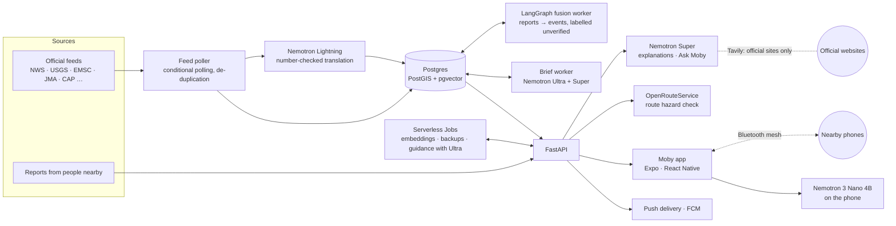

| Part | Path | What it is |
|---|---|---|
| App | `src/`, `modules/`, `plugins/` | Expo / React Native. Firebase Auth and Firestore for accounts, FCM for push, App Check, MapLibre maps, SQLite for offline data, and a native Bluetooth module (`modules/moby-mesh`) for the mesh. |
| API contract | [`api-contract-v1.yaml`](api-contract-v1.yaml) | OpenAPI. The app's types are generated from it. |
| API | `moby/api/` | FastAPI: alerts, reports, guidance, Ask Moby, trips, routes, mesh sync, privacy export and deletion. |
| Feeds | `moby/feeds/` | One normaliser per network into one event schema, polled with ETag / If-Modified-Since, de-duplicated across networks and linked across updates. |
| Fusion and briefs | `moby/graph/` | LangGraph workers. The same hazard within 1 km and 2 hours becomes one event, counting distinct people. |
| Trust rules | `moby/escalation/`, `moby/alerts/` | Deterministic tiers and who gets notified. No model involved. |
| Delivery | `moby/delivery/` | Push notifications through FCM. |
| Data | `db/` | Postgres 17 with PostGIS and pgvector. |
| Hosting | `deploy/` | One Nebius Serverless Endpoint runs the API, Postgres, poller, push and AI workers. Serverless Jobs run embeddings, backups and guidance generation. MysteryBox holds secrets; Object Storage holds backups. |

</details>

<p align="right"><a href="#top">Back to top ↑</a></p>

---

## Run from source

### Requirements

| For | You need |
|---|---|
| The app | Node.js 22 (20+ works) and npm |
| Android builds | Android Studio (SDK and an emulator) and **JDK 17**. React Native's native build fails on newer JDKs. |
| iOS builds | macOS, Xcode with an iOS Simulator runtime, CocoaPods (`brew install cocoapods`) |
| The backend | Docker and [uv](https://docs.astral.sh/uv/) (Python 3.14 is installed from `.python-version`) |

<a id="a-the-app-with-demo-data"></a>
<a id="ios-from-source"></a>
<details open>
<summary><b>A. The app with demo data (no backend, about 2 minutes)</b></summary>

No backend, accounts or keys. Without `EXPO_PUBLIC_API_URL` the app uses built-in sample alerts, explanations
and answers from `src/api/fixtures.ts`. The walkthrough above works the same way, and emergency mode opens on
the first launch because the sample data includes a flash flood warning at your location.

```bash
git clone https://github.com/Xlient/Moby.git && cd Moby
npm ci
EXPO_PUBLIC_USE_MOCK=true npx expo start --web
```

Press `w` if the browser doesn't open, and use a phone-sized window.

**Android emulator** (JDK 17):

```bash
export JAVA_HOME=$(/usr/libexec/java_home -v 17)
export ANDROID_HOME=$HOME/Library/Android/sdk
npx expo run:android --variant release
```

On Linux, point `JAVA_HOME` at JDK 17 and use `ANDROID_HOME=~/Android/Sdk`.

**iOS:**

```bash
MOBY_PREBUILD_PLATFORM=ios npx expo run:ios --configuration Release
```

To install on your own iPhone, plug it in, add `--device`, and sign in to Xcode with any Apple ID. Free
signing lasts 7 days.

**App scripts** (`package.json`):

| Command | What it does |
|---|---|
| `npm start` / `npm run web` | Expo dev server (native / browser) |
| `npm run android` | Build and run on Android |
| `npm run typecheck` · `npm run lint` | TypeScript and ESLint (both run in CI) |
| `npm run test:lib` · `test:mesh` · `test:guidance` · `test:ondevice` | Unit tests (Node's test runner) |
| `npm run generate-types` | Regenerate `src/api/generated-types.ts` from [`api-contract-v1.yaml`](api-contract-v1.yaml) |
| `npm run emulators` · `npm run test:rules` | Firebase emulators and the Firestore rules tests |
| `npm run build:android:apk` | EAS cloud build (`preview` profile in [`eas.json`](eas.json)) |

</details>

<details>
<summary><b>B. The full stack (database, feeds, API, models)</b></summary>

**1. Database and live feeds.** [`docker-compose.yml`](docker-compose.yml) starts Postgres 17 (PostGIS and
pgvector), runs the migrations, and starts the feed poller, the report fusion worker and the brief worker. The
poller starts pulling real official alerts within a minute.

```bash
cp .env.example .env
docker compose up -d --build
docker compose logs -f poller
```

Press Ctrl-C once you see feeds succeed.

**2. The API** (`moby/api/app.py`), with sign-in switched off for local use:

```bash
uv sync
MOBY_AUTH_DISABLED=true MOBY_CORS_ORIGINS=http://localhost:8081 \
  uv run --env-file .env uvicorn moby.api.app:app --port 8000
```

```bash
curl "http://localhost:8000/v1/alerts?lat=37.77&lon=-122.42&radius_km=300"
```

**3. The app against your API.** In a browser:

```bash
EXPO_PUBLIC_USE_MOCK=false EXPO_PUBLIC_API_URL=http://localhost:8000/v1 npx expo start --web
```

On the Android emulator, which reaches your machine at `10.0.2.2`:

```bash
EXPO_PUBLIC_USE_MOCK=false EXPO_PUBLIC_API_URL=http://10.0.2.2:8000/v1 npx expo run:android
```

**4. AI and routing (optional).** Add keys to `.env`:

| Variable | Get one at | Turns on |
|---|---|---|
| `N_FACTORY_ACC_KEY` | [Nebius Token Factory](https://tokenfactory.nebius.com/) | Translation, *What this means for you*, Ask Moby, trip briefs and situation briefs |
| `TAVILY_API_KEY` | [Tavily](https://tavily.com/) | Official-site search for Ask Moby and trip briefs |
| `ORS_API_KEY` | [OpenRouteService](https://openrouteservice.org/dev/#/signup) (free) | Route hazard check |

Then restart the API and recreate the workers. Compose reads `.env` when it creates a container, so a plain
`restart` keeps the old values.

```bash
docker compose up -d poller fusion briefs
uv run --env-file .env python -m moby.feeds --once --feed explain
uv run --env-file .env python scripts/verify_models.py
```

The second command embeds the guidance for Ask Moby; the third checks the key reaches Nano, Super, Ultra and the
embedder. Without keys, alerts, maps, guidance and reports all still work.

**Tests.** Backend: `uv run --env-file .env pytest` (uses the Docker database). App: the scripts above.
Evaluations that call models run only in the gated [`model-evals`](.github/workflows/model-evals.yml) workflow.

The entry points are `moby.api.app`, `python -m moby.feeds` and `python -m moby.delivery`. Deployment to Nebius
is `deploy/nebius/deploy.sh` (maintainer only).

</details>

<a id="releasing-maintainers"></a>
<details>
<summary><b>Releasing (maintainers)</b></summary>

Push a version tag: `git tag v1.1.0 && git push origin v1.1.0`.

| Workflow | On a `v*` tag | By hand |
|---|---|---|
| [`android-release.yml`](.github/workflows/android-release.yml) | Signed APK + AAB, attached to the GitHub Release | Optional Google Play upload, approved in the `play` environment |
| [`ios-simulator.yml`](.github/workflows/ios-simulator.yml) | Simulator `.app`, attached to the GitHub Release | Any time |
| [`ios-release.yml`](.github/workflows/ios-release.yml) | App Store build uploaded to **TestFlight** (once `IOS_RELEASE_ENABLED` is set) | `testflight` again, or `submit`: send a tested TestFlight build to App Store review, approved in the `app-store` environment |

One-time iOS setup (needs the paid Apple Developer Program):

1. Create the app in App Store Connect with bundle id `com.xlient.moby`, and add an iOS app with that bundle id
   in Firebase. Turn on App Attest and DeviceCheck for App Check, and upload an APNs key for push.
2. App Store Connect → Users and Access → Integrations: create an API key with the **Admin** role. Xcode needs
   it to create the distribution certificate and profile; nothing is stored in the repo.
3. Repository secrets: `APP_STORE_CONNECT_API_KEY_BASE64` (`base64 -i AuthKey_XXXX.p8`),
   `APP_STORE_CONNECT_KEY_ID`, `APP_STORE_CONNECT_ISSUER_ID`, `APPLE_TEAM_ID`, and
   `GOOGLE_SERVICES_PLIST_BASE64` (`base64 -i GoogleService-Info.plist`). `EXPO_PUBLIC_API_URL` is shared.
4. Repository variable `IOS_RELEASE_ENABLED` = `true`, and an environment `app-store` with yourself as
   required reviewer.
5. Before the first `submit`, fill in the store listing, screenshots, privacy answers and review notes (with a
   test account) in App Store Connect. The workflow submits the build; it doesn't write the listing.

</details>

<p align="right"><a href="#top">Back to top ↑</a></p>

---

## Contributing

**The goal:** a warning issued anywhere in the world should reach the people it's meant for, in a language
they read, with clear steps, even when the network is down.

Help is welcome in every part of Moby:

| Area | Examples |
|---|---|
| **Official sources** | Add a feed for a country Moby doesn't cover yet: a national weather or geological service, or a Common Alerting Protocol feed (`moby/feeds/`). |
| **Languages** | Improve a translation or the plain-language wording in the app. |
| **Offline and mesh** | On-device answers (`src/ondevice/`) and the Bluetooth mesh (`modules/moby-mesh`). |
| **App** | Screens, accessibility and performance on low-end phones (`src/`). The demo data in `src/api/fixtures.ts` covers every screen, so no backend is needed. |
| **Evaluations and tests** | Grounding and translation checks, feed parsers, end-to-end flows. |

Start with [CONTRIBUTING.md](CONTRIBUTING.md) for setup, the checks CI runs, and the guidelines. Issues
labelled [`good first issue`](https://github.com/Xlient/Moby/labels/good%20first%20issue) and
[`help wanted`](https://github.com/Xlient/Moby/labels/help%20wanted) are good places to begin. Every change
keeps these principles:

1. **Trust stays visible.** Unverified reports never look like official warnings.
2. **Never a false all-clear.** If the app can't check, it says so.
3. **Critical alerts always get through.** No setting hides a critical alert near the user.
4. **Translations are labelled.** Machine translation is marked, with the original one tap away.

Everyone taking part follows the [Code of Conduct](CODE_OF_CONDUCT.md) (Contributor Covenant 2.1).

<p align="right"><a href="#top">Back to top ↑</a></p>

---

## Sponsoring

Moby is free and has no ads. Running the live service costs money every day: hosting on Nebius, model calls
for translations and explanations, and official-site search. Sponsorship pays for those, and for new regions,
the Bluetooth mesh and offline features.

**[Sponsor Moby on GitHub](https://github.com/sponsors/Xlient).** [SPONSORS.md](SPONSORS.md) lists the tiers,
what each includes, and current sponsors. Sponsorship never buys a say in which warnings are shown, how they
are ranked or labelled, or what the safety guidance says.

<p align="right"><a href="#top">Back to top ↑</a></p>

---

## Privacy

Moby collects as little as it can. Export or delete your data in **Settings → Privacy & data**. Ask Moby
questions aren't stored, and a route check sends only its start and end points to OpenRouteService. See the
[privacy policy](legal/privacy.md) and [terms](legal/terms.md).

<p align="right"><a href="#top">Back to top ↑</a></p>

## Data sources

<details>
<summary><b>Official services and other sources Moby uses</b></summary>

Warnings come from official services including the US National Weather Service, USGS, NASA EONET, GDACS, the
Pacific Tsunami Warning Center, the National Hurricane Center, the Joint Typhoon Warning Center, EMSC, the Japan
Meteorological Agency, Nepal's BIPAD portal, MeteoAlarm and its member services, and national services
publishing Common Alerting Protocol feeds. Safety guidance comes from FEMA (Ready.gov) and the National Weather
Service. Routes come from OpenRouteService and OpenStreetMap contributors. These organisations do not endorse
Moby.

</details>

Moby was started for the Nebius × NVIDIA Global AI Hackathon. The first commit is from 20 September 2026,
inside the submission period.

<p align="right"><a href="#top">Back to top ↑</a></p>

## Security

Please report vulnerabilities privately as described in [SECURITY.md](SECURITY.md), not in a public issue.

<p align="right"><a href="#top">Back to top ↑</a></p>

## License

Moby is free software under the [GNU General Public License v3.0](LICENSE). The on-device model is downloaded
separately under the NVIDIA Nemotron Open Model License.

<p align="right"><a href="#top">Back to top ↑</a></p>
