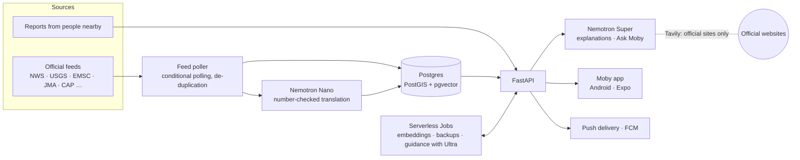

<div align="center">

# Moby: early warnings that reach you

**An open-source disaster early-warning app for locals and travellers in places where official alerts don't reach.**
Moby brings official hazard warnings from around the world together with reports from people on the ground,
explains them in plain words with NVIDIA Nemotron, and tells you what to do, even with little or no signal.

[](LICENSE)


[](https://github.com/sponsors/Xlient)

</div>

> ⚠️ **Moby complements official warning systems; it does not replace them.** Always follow
> instructions from local authorities and emergency services.

---

## Try it

| | How |
|---|---|
| **Android app (live backend)** | Join the closed test: TODO_PLAY_OPT_IN_LINK, or install the signed APK from [Releases](https://github.com/Xlient/Moby/releases) |
| **Sign in** | With any Google account, or the test account in the Devpost testing instructions |
| **No Android phone?** | Run the app in a browser with demo data in about 2 minutes: [Run it locally → A](#a-the-app-with-demo-data-2-minutes) |
| **Everything on your machine** | Backend, database, live feeds and app: [Run it locally → B](#b-the-full-stack) |

**A five-minute tour**

1. **Home:** official alerts near you, with a radius you choose. Each one shows who issued it and how sure Moby is.
   Nothing near you right now? Tap *Watching within…* to widen the radius, or leave location off to see the
   alerts around San Francisco.
2. **Open an official alert:** *What this means for you* explains the warning in plain words (Nemotron Super).
   The agency's own text is right below, and non-English warnings are translated (Nemotron Nano) with the original one tap away.
3. **What to do:** safety guidance and local emergency numbers, saved on the phone so they work offline.
4. **Assistant tab (Ask Moby):** ask "What should I do if the road ahead is flooded?". The answer cites its
   sources (official alerts, guidance, official government websites found with Tavily). Ask something
   off-topic and Moby says it can't answer rather than guessing.
5. **Settings → About → How Moby uses AI:** which model does what, and what AI never decides.

## Why

Floods, typhoons, earthquakes and wildfires are most dangerous where warnings struggle to arrive:
trekking routes, valleys, rural areas, places where towers fail first. Travellers have it worst, since
warnings come in a language they don't read, from agencies they've never heard of. Moby is built for that moment:

- **Watches official sources worldwide:** national weather services, earthquake and tsunami centres,
  typhoon and hurricane centres, and Common Alerting Protocol feeds, shown only when they're near you.
- **Makes warnings understandable:** a translation in your language and a plain-language explanation,
  both checked against the agency's text before you see them.
- **Treats trust as a first-class feature:** an agency warning and a report from people nearby always look different.
  A rumour should never look like a government warning.
- **Works offline:** last-known alerts, safety guidance and emergency numbers stay on your phone.

## How Moby uses NVIDIA Nemotron on Nebius Token Factory

Every model call is behind a check, and **models never decide whether something is confirmed or how
urgent it is**. Those are deterministic rules (`moby/escalation/`).

| Model (Token Factory) | What it does in Moby | How it's kept honest |
|---|---|---|
| **Nemotron 3 Nano** | Translates non-English warnings (Japanese, Spanish, Nepali…) into English, on ingest. Fast and cheap, so it's used for the high-volume path. Also rewrites Ask Moby questions into generic search queries without personal details. | Every number in the original (times, levels, magnitudes) must survive, or the translation is discarded and the original is shown (`moby/feeds/translate.py`). |
| **Nemotron 3 Super** | *What this means for you*: 2–3 plain sentences and up to 3 actions per official warning, cached per event. **Ask Moby**: answers with `[n]` citations. | Grounding checks (`moby/ai/grounding.py`): no number that isn't in the source, and the answer's words must come from the sources it cites; otherwise it's withheld. Ask Moby abstains when its sources don't cover the question. |
| **Nemotron 3 Ultra** | Writes the offline safety guidance cards from official pages (Ready.gov, NWS…), as a Serverless Job. | Every line must cite the line of the source page it came from (`moby/jobs/guidance.py`). |
| **Qwen3-Embedding-8B** | Retrieval for Ask Moby over the guidance cards (pgvector), and event embeddings. | Similarity cut-offs measured on real questions. |

**Why Token Factory:** an OpenAI-compatible API with the Nemotron Nano / Super / Ultra tiers. Moby uses
Nano for the high-volume, latency-sensitive work, Super for what users read interactively, and Ultra
for the slow, careful offline work, as the [track description](https://nebiusglobalaihackathon.devpost.com/)
suggests. One switch (`moby/llm.py`) decides which model each feature uses.

**Other Nebius services**
- **Serverless Endpoint:** one container runs the API, Postgres (PostGIS + pgvector), the feed poller,
  push delivery, translation and the explainer (`deploy/endpoint/`).
- **Serverless Jobs:** embeddings, nightly backups, guidance generation (`moby/jobs/`).
- **MysteryBox** for secrets, **Object Storage** for backups, **Container Registry** for images (`deploy/nebius/deploy.sh`).

**Tavily:** when Moby's guidance doesn't cover a question, Ask Moby searches **only the country's official
government domains** (`moby/search/official.py`). The query is rewritten first so no personal details leave the
phone's question. Tavily also finds official guidance pages for new countries (`scripts/discover_guidance_sources.py`).

**Cost guardrails:** every paid call (translation, explanations, Ask Moby, Tavily) has a daily cap
(`moby/ai/budget.py`). Past it, features fall back to the official text instead of spending more.

## Features

| | Status |
|---|---|
| Official alerts worldwide: NWS, USGS, EMSC, GDACS, NASA EONET, PTWC, NHC, JTWC, JMA, BIPAD, MeteoAlarm and national CAP feeds | ✅ |
| Translated warnings (number-checked) and *What this means for you* explanations | ✅ |
| Ask Moby: a cited safety assistant (Nemotron + pgvector + Tavily) | ✅ |
| Push notifications for alerts near you and in saved areas; you choose hazards and severity | ✅ |
| Offline safety guidance with sources, and local emergency numbers | ✅ |
| Community hazard reports, always labelled unverified, with how many people reported | ✅ |
| Privacy controls: export or delete your data, choose what's shared (GDPR) | ✅ |
| AI pipeline that fuses reports with official data (LangGraph + Nemotron) | 🚧 in progress |
| Bluetooth relay between phones with no signal | 🚧 in the app, off by default |

## How it works



- **Backend** (`moby/`): Python, FastAPI, psycopg, LangGraph. Feeds are polled with ETag /
  If-Modified-Since, normalised into one event schema, de-duplicated across networks, and linked across updates.
- **Data:** Postgres 17 with PostGIS (where things are) and pgvector (what they're about).
- **App** (`src/`): Expo / React Native, Firebase Auth and Firestore for accounts, FCM for push, App Check.
- **API contract:** [`api-contract-v1.yaml`](api-contract-v1.yaml) (OpenAPI); app types are generated from it.

## Run it locally

### A. The app with demo data (2 minutes)

Needs Node.js 20+. No backend, accounts or keys: the app uses built-in sample alerts, explanations and answers.

```bash
git clone https://github.com/Xlient/Moby.git && cd Moby
npm ci
EXPO_PUBLIC_USE_MOCK=true npx expo start --web
```

Press `w` if the browser doesn't open. Use a phone-sized window, or your browser's device toolbar.

### B. The full stack

Needs Docker, [uv](https://docs.astral.sh/uv/) and Node.js 20+. For the Android app, also Android Studio
(SDK and an emulator) and **JDK 17**.

**1. Database and live feeds.** This starts Postgres (PostGIS + pgvector), runs the migrations and starts
the poller, which begins pulling real official alerts within a minute:

```bash
cp .env.example .env
docker compose up -d --build
docker compose logs -f poller        # Ctrl-C when you see feeds succeed
```

**2. The API.** Sign-in is switched off for local use:

```bash
uv sync
MOBY_AUTH_DISABLED=true MOBY_CORS_ORIGINS=http://localhost:8081 \
  uv run --env-file .env uvicorn moby.api.app:app --port 8000
curl "http://localhost:8000/v1/alerts?lat=37.77&lon=-122.42&radius_km=300"
```

**3. The app against your API.** In a browser:

```bash
EXPO_PUBLIC_USE_MOCK=false EXPO_PUBLIC_API_URL=http://localhost:8000/v1 npx expo start --web
```

Or on the Android emulator (the emulator reaches your machine at `10.0.2.2`). Maps fall back to a drawn
map without a Google Maps key.

```bash
EXPO_PUBLIC_USE_MOCK=false EXPO_PUBLIC_API_URL=http://10.0.2.2:8000/v1 npx expo run:android
```

**4. AI features (optional).** Add your keys to `.env`, then restart the API and the poller:
- `N_FACTORY_ACC_KEY`: a [Nebius Token Factory](https://tokenfactory.nebius.com/) key. This turns on
  translation, *What this means for you* and Ask Moby.
- `TAVILY_API_KEY`: a [Tavily](https://tavily.com/) key. Ask Moby can then search official websites.

```bash
docker compose up -d poller
uv run --env-file .env python -m moby.feeds --once explain   # embed guidance for Ask Moby
```

Without keys, everything else works: alerts, maps, guidance and reports.

**Tests:** `uv run --env-file .env pytest` (backend; uses the Docker database), `npx tsc --noEmit` (app).
Model-calling evaluations run only in the gated `model-evals` workflow.

## Built during the hackathon

Moby was started for the Nebius × NVIDIA Global AI Hackathon: the first commit is from 20 September 2026,
inside the submission period. Everything here was built during it.

## Privacy

Moby collects as little as it can, and you can export or delete your data in the app (Settings → Privacy).
See the [privacy policy](legal/privacy.md). Ask Moby questions aren't stored.

## Contributing

Issues and pull requests are welcome. Please keep two principles intact in any change:

1. **Trust stays visible.** Unverified reports must never look like official warnings.
2. **Never a false all-clear.** If the app can't check, it says so; it never shows "all quiet".

Run the tests before opening a PR (`uv run pytest` for the backend, `npx tsc --noEmit` for the app).

